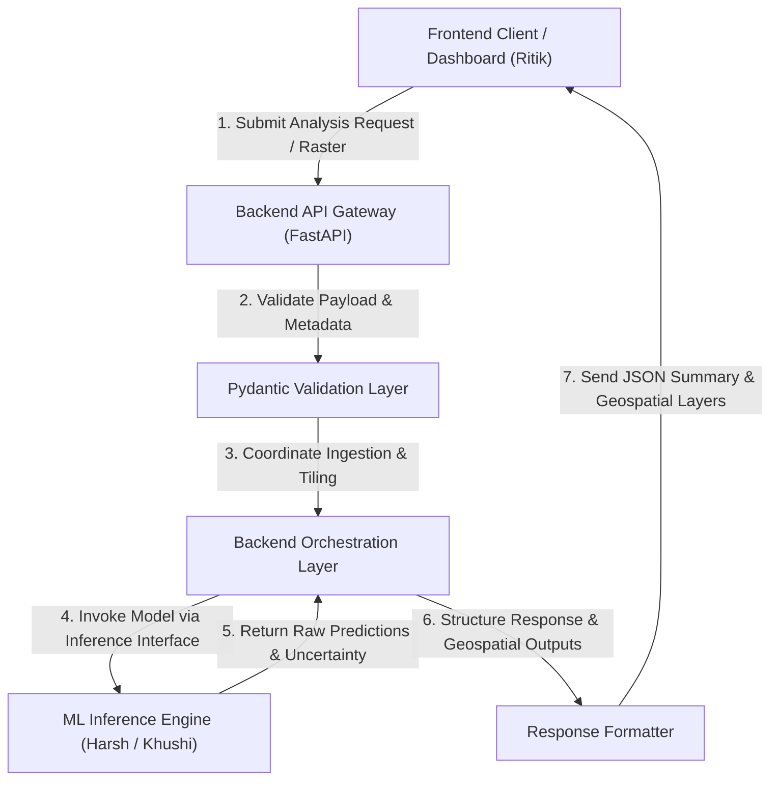

# TerraSpectra — Backend Scope & Architecture Specification

**Module:** Backend Service  
**Owner:** Kanishka (Backend Engineering)  
**Team:** Team Strangers — TerraSpectra  
**Status:** Week 1 Specification  
**Version:** 0.1.0  

---

## 1. Purpose of the Backend

The TerraSpectra backend serves as the core orchestration and integration layer for the hyperspectral crop stress intelligence and disease-risk forecasting platform. It bridges the client-facing user interface managed by the Frontend team (Ritik) and the computational machine learning pipelines developed by the ML and Data teams (Harsh and Khushi).

Primary purposes of the backend service:
- Provide stable, well-defined RESTful API endpoints for client applications and GIS dashboards.
- Manage the end-to-end inference lifecycle: receiving analysis requests, validating raster metadata, invoking machine learning models, and packaging predictions.
- Enforce strict data validation contracts on all incoming requests and outgoing responses using Pydantic schemas.
- Abstract the complexities of deep learning execution, tensor transformations, and geospatial raster handling away from the frontend client.
- Deliver standardized error handling, structured logging, and health diagnostics to ensure reliable system operation.

---

## 2. Overall Project Workflow

The TerraSpectra platform processes hyperspectral satellite imagery to detect crop stress indicators and forecast disease risk. The backend coordinates the flow of data across system boundaries.



### End-to-End Workflow Stages:
1. **Request Submission:** The frontend client submits an analysis request containing geospatial parameters or an uploaded hyperspectral scene.
2. **Request Validation:** The backend intercepts the request and verifies all input parameters, file headers, and geospatial metadata against strict Pydantic schemas.
3. **Data Preparation & Verification:** The backend confirms that the input data conforms to the ML data contract (e.g., spatial coordinate validity, band ordering integrity, and absence of corrupted data).
4. **Model Invocation:** The backend calls the ML inference interface (`terraspectra_ml.inference.predict`), dispatching the prepared data to the model.
5. **Prediction Generation:** The ML module runs the hybrid model (or baseline model) and returns prediction arrays, class logits, and uncertainty estimates.
6. **Response Transformation & Georeferencing:** The backend translates raw tensor and array outputs into structured JSON metrics and georeferenced raster products (e.g., GeoTIFF with preserved Coordinate Reference System and Affine transforms).
7. **Client Presentation:** The frontend consumes the structured response to render risk dashboards, stress visualizations, and statistical summaries.

---

## 3. Backend Responsibilities

The backend service is responsible for the following technical domains:

- **API Lifecycle & Ingestion:** Receiving and processing HTTP requests from the frontend client, including file uploads and job status queries.
- **Contract Enforcement:** Validating request structures, field boundaries, and raster metadata prior to triggering computational tasks.
- **Orchestration of ML Workflows:** Interfacing with the ML inference module in a clean, decoupled manner without exposing model internals to the client.
- **Data Transformation:** Converting raw model outputs (numerical matrices, logits, uncertainty values) into human-readable and GIS-compatible formats.
- **Geospatial Coordinate Integrity:** Preserving raster spatial references (CRS and Affine transformation matrices) during data processing and output generation.
- **Error Handling & Resilience:** Trapping runtime exceptions, model failures, and invalid data inputs, and returning uniform HTTP error responses.
- **Operational Health:** Providing health check, readiness, and system status endpoints for platform monitoring.
- **Mock Services for Early Enablement:** Providing mock inference endpoints during early development phases so the frontend team can progress independently of ML model training cycles.

---

## 4. API Routing Responsibilities

The backend manages structured, versioned RESTful routes (`/api/v1`) designed for clarity, maintainability, and clear separation of concerns.

### Planned Route Groups:

| Route Group | Path | Method | Purpose |
| :--- | :--- | :--- | :--- |
| **System Diagnostics** | `/health` | `GET` | Basic service liveness and uptime check. |
| | `/api/v1/system/status` | `GET` | Readiness check including ML module availability and compute resource status. |
| **Metadata & Discovery** | `/api/v1/models/info` | `GET` | Returns active model metadata, supported sensor types (TBD), and version tags. |
| | `/api/v1/datasets/supported` | `GET` | Returns supported hyperspectral sensors and band configurations (TBD). |
| **Inference & Analysis** | `/api/v1/inference/analyze` | `POST` | Initiates an analysis job on an uploaded scene or registered dataset. |
| | `/api/v1/inference/jobs/{job_id}` | `GET` | Checks the status and progress of an ongoing analysis job. |
| **Results & Export** | `/api/v1/results/{job_id}/summary` | `GET` | Retrieves structured summary statistics and risk metrics for a completed job. |
| | `/api/v1/results/{job_id}/raster` | `GET` | Downloads or streams the georeferenced prediction raster output (e.g., GeoTIFF). |

Routing logic is kept strictly isolated from computational business logic: routes only parse requests, delegate work to service classes, and return responses.

---

## 5. Request and Response Validation Using Pydantic

All incoming payloads and outgoing responses pass through strict Pydantic models. This eliminates malformed data, prevents type mismatch runtime errors, and guarantees consistent communication with the frontend.

### 5.1 Request Validation Responsibilities:
- Validate presence and types of all required fields.
- Validate geospatial coordinate ranges (e.g., latitude $\in [-90.0, 90.0]$, longitude $\in [-180.0, 180.0]$).
- Validate file extensions and MIME types for uploaded raster assets (e.g., `.tif`, `.tiff`, `.hdr` — specific accepted formats TBD).
- Reject payloads containing negative dimensions, invalid identifiers, or out-of-range parameters before computational resources are engaged.

### 5.2 Response Validation Responsibilities:
- Ensure all API responses adhere to a fixed schema.
- Validate that probability values and confidence scores fall strictly within the $[0.0, 1.0]$ range.
- Guarantee that required metadata (timestamps, job IDs, execution status) is always present.

### 5.3 Baseline Schema Specifications:

```python
# Conceptual Pydantic models (exact fields subject to integration finalization)

from pydantic import BaseModel, Field
from typing import Optional, List, Dict, Any

class AnalysisRequestSchema(BaseModel):
    """Validation schema for incoming inference requests."""
    dataset_id: Optional[str] = Field(None, description="Identifier of pre-registered dataset")
    sensor_name: Optional[str] = Field(None, description="Target sensor name (TBD, e.g., EnMAP, PRISMA)")
    bounding_box: Optional[List[float]] = Field(
        None, 
        min_length=4, 
        max_length=4, 
        description="Bounding box [min_lon, min_lat, max_lon, max_lat] in EPSG:4326"
    )
    include_uncertainty: bool = Field(True, description="Whether to compute uncertainty maps")

class PredictionMetricsSchema(BaseModel):
    """Validation schema for prediction summary metrics."""
    dominant_class: str = Field(..., description="Dominant predicted category (TBD)")
    class_distribution: Dict[str, float] = Field(..., description="Percentage coverage per class")
    mean_confidence: float = Field(..., ge=0.0, le=1.0, description="Mean prediction confidence")
    mean_uncertainty: Optional[float] = Field(None, ge=0.0, le=1.0, description="Mean estimated uncertainty")

class StandardResponseEnvelope(BaseModel):
    """Uniform response envelope for all successful API responses."""
    status: str = Field("success", description="Response status: success | error")
    timestamp: str = Field(..., description="ISO 8601 UTC timestamp")
    job_id: str = Field(..., description="Unique task identifier")
    data: Dict[str, Any] = Field(..., description="Validated payload data")
```

---

## 6. Model Invocation Interface

The backend interacts with the machine learning module through an explicit service layer (`InferenceService`). This boundary isolates the backend web framework from deep learning dependencies.

### Key Invocation Rules:
- **Decoupled Boundary:** The web server does not import raw neural network definitions directly into route controllers. It interacts with `terraspectra_ml.inference` entry points.
- **Contract Adherence:** The backend ensures that input data fed to the ML interface conforms to the ML data contract:
  - Input layout: 5D volumetric tensor layout `[Batch, Channels, Depth, Height, Width]` where `Channels = 1` as specified by the ML Lead (Harsh).
  - Spectral bands ($D$): Exact count is **TBD** pending dataset selection by Khushi and Harsh.
  - Spatial patch dimensions ($H, W$): Proposed as $11 \times 11$, $13 \times 13$, or $15 \times 15$ (**TBD** pending model experiments).
  - Data type: Normalized single-precision floating point (`float32`).
- **Execution Safety:** The invocation layer handles hardware execution contingencies:
  - Detects CUDA GPU availability, falling back to CPU execution if GPU resources are absent.
  - Intercepts out-of-memory (OOM) or tensor shape mismatches and converts them into informative backend errors.
  - Isolates long-running inference jobs into background tasks to prevent blocking the HTTP server event loop.

---

## 7. Response Formatting

Raw outputs from the ML model (arrays of class predictions, probability distributions, and uncertainty values) cannot be directly consumed by frontend components. The backend formats and packages these outputs into two standard response types:

### 7.1 Structured JSON Summary Response
Delivers high-level metrics and categorical summaries for the dashboard:
- Unique analysis job identifier (`job_id`).
- Execution duration and timestamp.
- Predicted class distribution (percentages of analyzed area).
- Overall confidence and uncertainty statistics.
- Bounding coordinates and spatial extent metadata.

### 7.2 Geospatial Raster Product
For spatial visualization on the frontend map:
- Outputs a georeferenced raster (e.g., Cloud Optimized GeoTIFF or standard GeoTIFF).
- Embeds the original Coordinate Reference System (CRS) and Affine Transform matrix to prevent spatial distortion or geographic displacement.
- Encodes prediction class indices and uncertainty bands into standardized raster layers.

### Standard Response Format:

```json
{
  "status": "success",
  "timestamp": "2026-11-12T10:00:00Z",
  "job_id": "job_exp_001",
  "data": {
    "metadata": {
      "sensor": "TBD",
      "crs": "EPSG:4326",
      "spatial_dimensions": { "height": 0, "width": 0 }
    },
    "metrics": {
      "dominant_class": "TBD",
      "class_distribution": {},
      "mean_confidence": 0.0,
      "mean_uncertainty": 0.0
    },
    "artifacts": {
      "raster_download_url": "/api/v1/results/job_exp_001/raster",
      "summary_url": "/api/v1/results/job_exp_001/summary"
    }
  }
}
```

---

## 8. Error Handling

The backend implements a centralized, predictable error handling strategy. Uncaught exceptions are intercepted and converted into standardized JSON error envelopes with appropriate HTTP status codes.

### Standard Error Response Envelope:

```json
{
  "status": "error",
  "timestamp": "2026-11-12T10:00:00Z",
  "error_code": "INVALID_RASTER_METADATA",
  "message": "The uploaded raster file is missing a valid Coordinate Reference System (CRS).",
  "details": {
    "field": "crs",
    "issue": "Affine transform or projection matrix could not be resolved."
  }
}
```

### Handled Error Categories:

| HTTP Status | Condition | Handling Behavior |
| :--- | :--- | :--- |
| **400 Bad Request** | Corrupted raster file, unsupported format, or invalid parameters. | Reject immediately with descriptive validation message. |
| **404 Not Found** | Requested job ID, scene ID, or raster artifact does not exist. | Return resource not found notification. |
| **422 Unprocessable Entity** | Pydantic schema validation failure (e.g., malformed types, missing mandatory fields). | Return field-specific validation failure details. |
| **500 Internal Error** | Unhandled server exception or unexpected data processing failure. | Log stack trace internally; return sanitized error message to client. |
| **502 Bad Gateway / ML Failure** | Model inference crash, checkpoint loading failure, or tensor mismatch. | Capture ML runtime error, preserve diagnostics in logs, return clear failure status. |
| **503 Service Unavailable** | Compute resources exhausted, GPU out-of-memory, or model service offline. | Inform client of capacity limit; recommend retry. |

---

## 9. Responsibilities Outside Backend Scope

To preserve clean architectural boundaries, the following areas are strictly **outside** the backend engineering scope:

- **Machine Learning Architecture & Training:** Model selection (3D-CNN, ViT, hybrid variants), network layers, loss functions, optimizer selection, hyperparameter tuning, and training loops (owned by Harsh).
- **Dataset Intake & Spectral Preprocessing:** Raw hyperspectral satellite data acquisition, atmospheric correction, band radiometric calibration, and spectral quality verification (owned by Khushi).
- **Ground-Truth Label Verification:** Validating whether dataset labels reflect land-cover, biophysical stress, or confirmed crop pathology (owned by Khushi and Harsh).
- **Frontend UI & Geospatial Map Rendering:** Web interface visual design, component layout, color palettes, client-side state management, and Leaflet/MapLibre map layer styling (owned by Ritik).
- **Agronomic Ground Truth:** Direct biological verification of crop disease etiology in the field.

---

## 10. Week 1 Objectives

During Week 1, backend engineering focuses on establishing foundations, contracts, and unblocking cross-functional collaboration.

1. **Backend Environment Setup:**
   - Initialize Python project structure for backend services.
   - Configure dependencies (`FastAPI`, `Pydantic`, `Uvicorn`, `Rasterio`).
   - Establish development and testing workflows.
2. **Foundational API & Health Endpoints:**
   - Implement root and health check endpoints (`/health`, `/api/v1/system/status`).
   - Validate basic service startup and operational logging.
3. **Pydantic Schema Definitions:**
   - Define baseline Pydantic models for request validation and response envelopes.
   - Ensure schemas accommodate unconfirmed fields cleanly using placeholder specifications.
4. **Mock Inference Interface:**
   - Implement a mock inference service that returns synthetically generated, schema-compliant responses.
   - Enables the Frontend team (Ritik) to connect dashboard UI components immediately without waiting for trained ML checkpoints.
5. **Contract Documentation & Alignment:**
   - Author and maintain backend documentation (`docs/backend/backend_scope.md` and `docs/backend/open_questions.md`).
   - Review ML data contracts with Harsh and Khushi to ensure alignment on tensor formats and metadata handling.
   - Engage Ritik to confirm frontend expectations regarding coordinate systems and response payloads.

